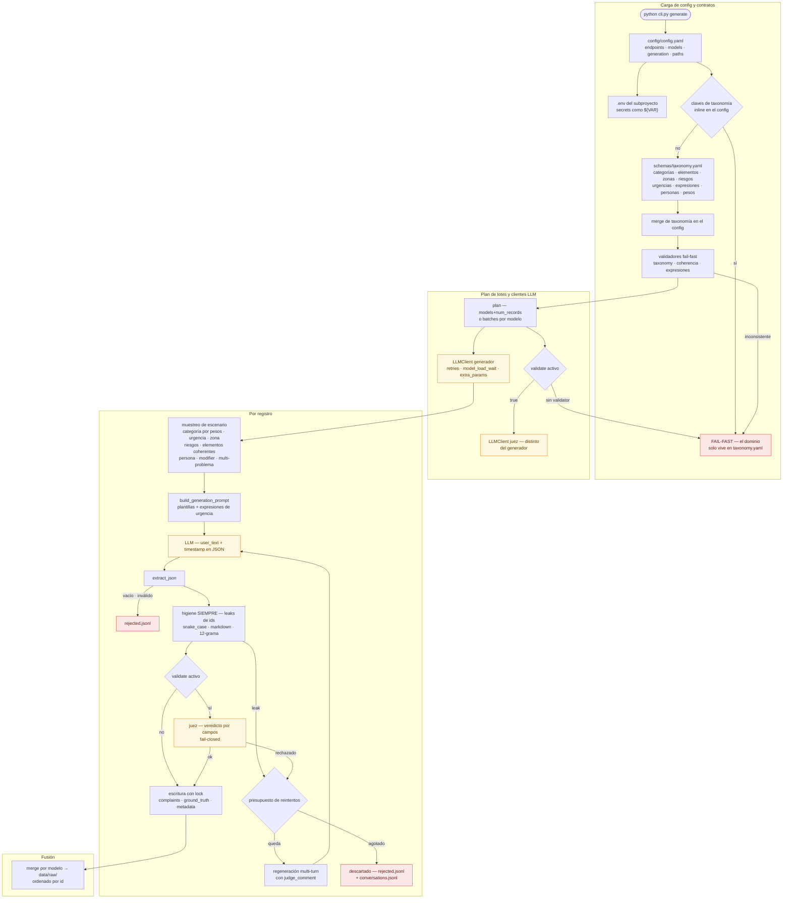
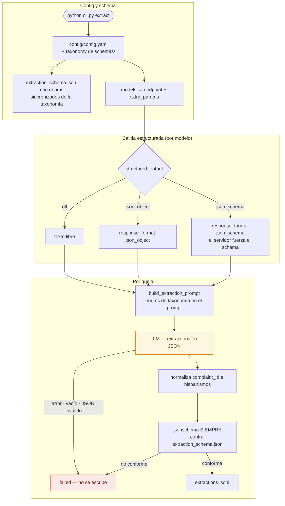
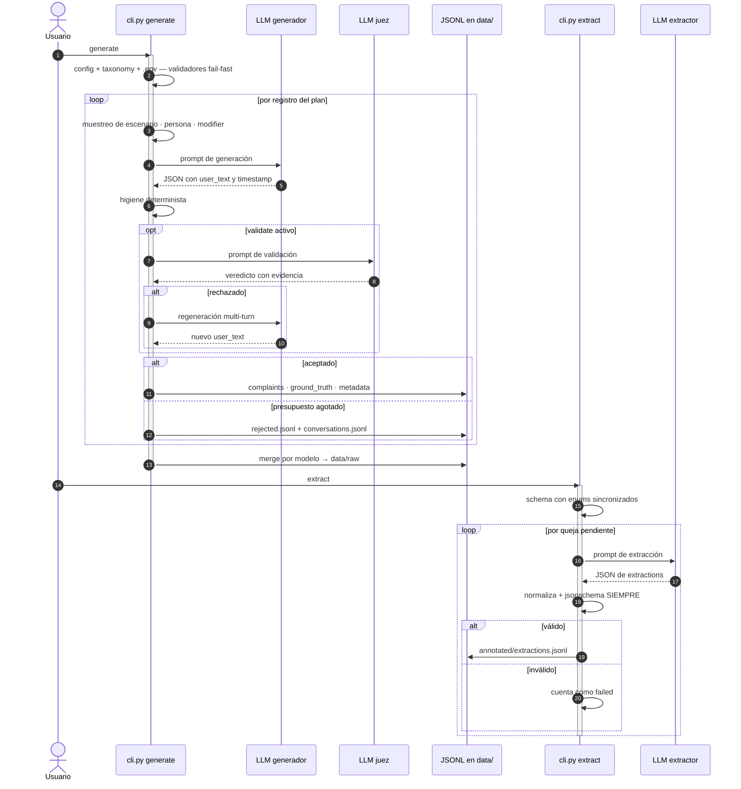

# miUrba

Generación sintética y extracción estructurada de quejas vecinales.
Dos herramientas independientes sobre contratos compartidos:

- **`miurba-generator/`** — genera datasets sintéticos de quejas: texto del
  vecino (LLM) y ground truth estructurado.
- **`miurba-extractor/`** — extrae estructura de quejas reales o sintéticas
  (texto) con un LLM, conforme a un JSON Schema.

La raíz del repo solo contiene **contratos**: los JSON Schema de datos y el
vocabulario de dominio (`schemas/taxonomy.yaml`). Cada subproyecto posee su
propio `config/` con su config por defecto y ejemplos.

## Estructura

```
mi-urba/
├── schemas/                     # contratos compartidos
│   ├── complaint_schema.json
│   ├── extraction_schema.json
│   └── taxonomy.yaml            # vocabulario de dominio (taxonomías, personas, pesos)
├── miurba-generator/
│   ├── cli.py                   # generate, merge
│   ├── config/                  # config.yaml + ejemplos (smoke, corpus, merge)
│   └── docker-compose.yaml
└── miurba-extractor/
    ├── cli.py                   # extract
    ├── config/                  # config.yaml + ejemplo json_schema
    └── docker-compose.yaml
```

## Flujo de datos

```
miurba-generator                          miurba-extractor
  escenario ─► LLM ─► user_text                user_text ─► LLM
       ▼                                          ▼
  complaints.jsonl + ground_truth.jsonl + metadata.jsonl    extractions.jsonl
       └────────────── entrada del extractor ──────────────┘
```

El nexo entre ambas es el formato de datos (`schemas/`), no código.

### Generator — `cli.py generate`



- La higiene determinista corre **siempre**; el juez semántico es opcional y
  **fail-closed**: un juez inalcanzable nunca aprueba.
- El ground truth se construye en código desde el escenario muestreado
  (alineado con `schemas/extraction_schema.json`); nunca lo escribe el LLM.

### Extractor — `cli.py extract`



- El modo `structured_output` restringe el muestreo **en el servidor**; la
  validación local contra el schema (enums sincronizados desde
  `taxonomy.yaml`) se aplica **siempre**.

### Pipeline end-to-end



## Requisitos

- Python 3.10+ (probado con 3.12)
- Un endpoint LLM OpenAI-compatible (vLLM, llama.cpp/llama-swap, Ollama…)

## Inicio rápido

```bash
# 1. Configura endpoints y modelos en <subproyecto>/config/config.yaml.
#    Los secretos van en <subproyecto>/.env (copia .env.example) y se
#    referencian como ${VAR}.

# 2. Generar quejas sintéticas
cd miurba-generator
python -m venv .venv && source .venv/bin/activate
pip install -r requirements.txt
python cli.py generate                # usa config/config.yaml

# 3. Extraer estructura de las quejas generadas: apunta raw_dir del
#    config del extractor a la salida del generador y ejecuta
#    python cli.py extract    # usa config/config.yaml
```

Salidas por defecto: `miurba-generator/data/<modelo>/raw/` en el generador y
`miurba-extractor/data/annotated/extractions.jsonl` en el extractor.

## Docker

Cada subproyecto tiene su propio compose:

```bash
cd miurba-generator && docker compose run --rm miurba-generator generate --config /app/config/config.yaml
cd miurba-extractor  && docker compose run --rm miurba-extractor  extract  --config /app/config/config.yaml
```

Montan `./config` (configs), `../schemas` (contratos), `./data` y `./logs`.

## Configuración

Cada subproyecto lee `config/config.yaml` (default) o lo que se pase con
`--config`. El vocabulario de dominio (taxonomías, personas, pesos) vive en
`schemas/taxonomy.yaml` y se referencia con `taxonomy:`; declararlo inline en
un config es un error fail-fast. Detalle en los README de cada subproyecto.

Ejemplos: `miurba-generator/config/{config-smoke,config-corpus,config-merge}.yaml`
y `miurba-extractor/config/config-jsonschema.yaml`.

## Testing

Ejecuta `pytest` **dentro** de cada subproyecto (los paquetes `src` son
independientes y colisionan si se lanzan desde la raíz):

```bash
cd miurba-generator && python -m pytest tests/
cd miurba-extractor && python -m pytest tests/
```

No requieren red.
