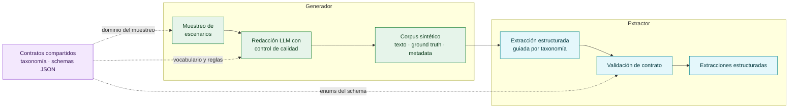
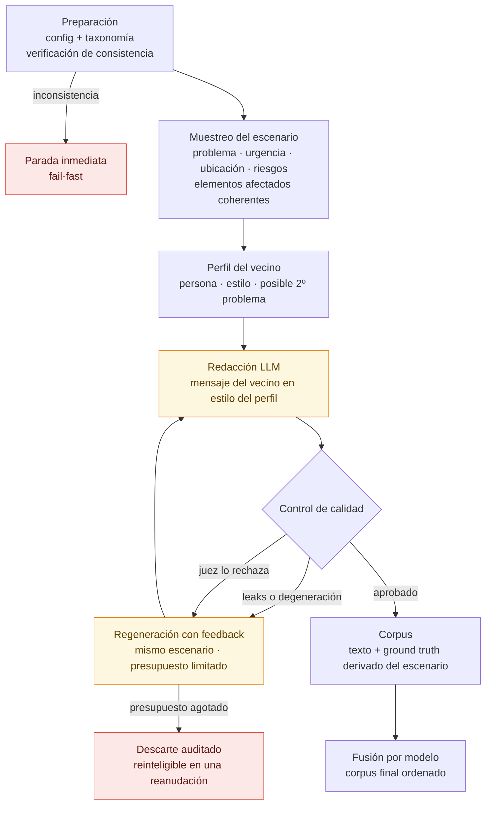
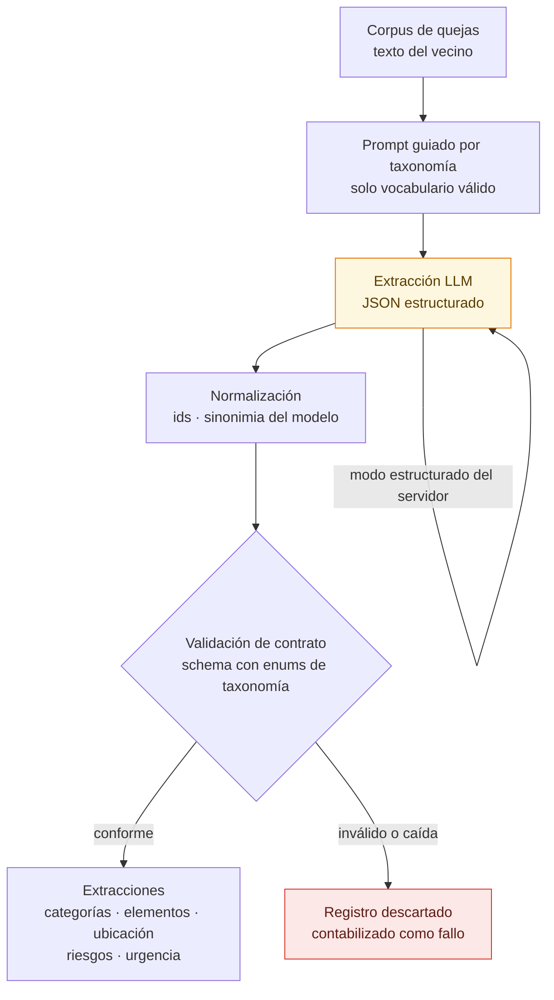
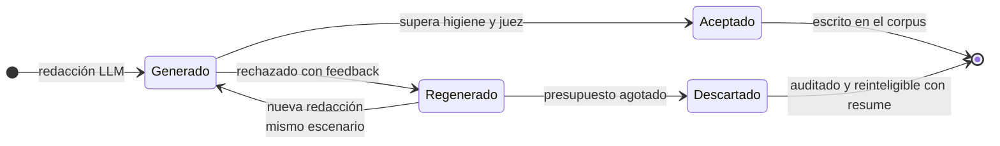

# miUrba

Generación sintética y extracción estructurada de quejas vecinales.
Dos herramientas independientes sobre contratos compartidos:

- **`miurba-generator/`** — genera datasets sintéticos de quejas: texto del
  vecino (LLM) y ground truth estructurado.
- **`miurba-extractor/`** — extrae estructura de quejas reales o sintéticas
  (texto) con un LLM, conforme a un JSON Schema.

La raíz del repo solo contiene **contratos**: los JSON Schema de datos y el
vocabulario de dominio (`schemas/taxonomy.yaml`). Cada subproyecto posee su
propio `config/` con su config por defecto y ejemplos.

## Estructura

```
mi-urba/
├── schemas/                     # contratos compartidos
│   ├── complaint_schema.json
│   ├── extraction_schema.json
│   └── taxonomy.yaml            # vocabulario de dominio (taxonomías, personas, pesos)
├── miurba-generator/
│   ├── cli.py                   # generate, merge
│   ├── config/                  # config.yaml + ejemplos (smoke, corpus, merge)
│   └── docker-compose.yaml
└── miurba-extractor/
    ├── cli.py                   # extract
    ├── config/                  # config.yaml + ejemplo json_schema
    └── docker-compose.yaml
```

## Flujo de datos

Vista funcional general: el **generador** construye un corpus sintético de
quejas a partir de escenarios muestreados de la taxonomía; el **extractor**
lee ese corpus y devuelve estructura conforme al contrato. Las dos
herramientas no comparten código: solo los contratos (taxonomía y schemas).



### Generador — bloques funcionales



Dos propiedades importantes del control de calidad: la **higiene**
determinista (sin ids internos, snake_case, markdown, bucles de degeneración)
corre siempre; el **juez** semántico es opcional y *fail-closed* — un juez
inalcanzable nunca cuenta como aprobación. El ground truth lo deriva el
sistema del escenario muestreado; nunca lo escribe el LLM.

### Extractor — bloques funcionales



La validación local contra el schema se aplica **siempre**, sea cual sea el
modo de muestreo del servidor (`json_object`, `json_schema` o libre).

### Ciclo de vida de un registro generado



## Requisitos

- Python 3.10+ (probado con 3.12)
- Un endpoint LLM OpenAI-compatible (configurado con `OPENAI_API_ENDPOINT`,
  `OPENAI_API_MODEL` y `OPENAI_API_KEY` en el `.env` del subproyecto)

## Inicio rápido

```bash
# 1. Configura tu endpoint en <subproyecto>/.env (copia .env.example):
#    OPENAI_API_ENDPOINT, OPENAI_API_MODEL, OPENAI_API_KEY.
#    Ajusta <subproyecto>/config/config.yaml solo si quieres cambiar el plan.

# 2. Generar quejas sintéticas
cd miurba-generator
python -m venv .venv
source .venv/bin/activate
pip install -r requirements.txt
python cli.py generate        # usa config/config.yaml

# 3. Extraer estructura de las quejas generadas: apunta raw_dir del
#    config del extractor a la salida del generador y ejecuta
cd ../miurba-extractor
python -m venv .venv
source .venv/bin/activate
pip install -r requirements.txt
python cli.py extract         # usa config/config.yaml
```

Salidas por defecto: `miurba-generator/data/<modelo>/raw/` en el generador y
`miurba-extractor/data/annotated/extractions.jsonl` en el extractor.

## Docker

Cada subproyecto tiene su propio compose:

```bash
cd miurba-generator
mkdir -p data logs
docker compose run --rm miurba-generator \
  generate --config /app/config/config.yaml

cd ../miurba-extractor
mkdir -p data logs
docker compose run --rm miurba-extractor \
  extract --config /app/config/config.yaml
```

Montan `./config` (configs), `../schemas` (contratos), `./data` y `./logs`;
el `.env` pasa vía `env_file`. Crea `data/` y `logs/` antes del primer run:
si no existen, docker los crea como root y el usuario del contenedor no
podrá escribir en ellos.

## Configuración

Cada subproyecto lee `config/config.yaml` (default) o lo que se pase con
`--config`. El vocabulario de dominio (taxonomías, personas, pesos) vive en
`schemas/taxonomy.yaml` y se referencia con `taxonomy:`; declararlo inline en
un config es un error fail-fast. Detalle en los README de cada subproyecto.

Ejemplos: `miurba-generator/config/{config-smoke,config-corpus,config-merge}.yaml`
y `miurba-extractor/config/config-jsonschema.yaml`.

## Testing

Ejecuta `pytest` **dentro** de cada subproyecto (los paquetes `src` son
independientes y colisionan si se lanzan desde la raíz):

```bash
# desde la raíz del repo
cd miurba-generator
pip install -r requirements-dev.txt
python -m pytest tests/

cd ../miurba-extractor
pip install -r requirements-dev.txt
python -m pytest tests/
```

No requieren red.

## Licencia

MIT — ver [LICENSE](LICENSE).
